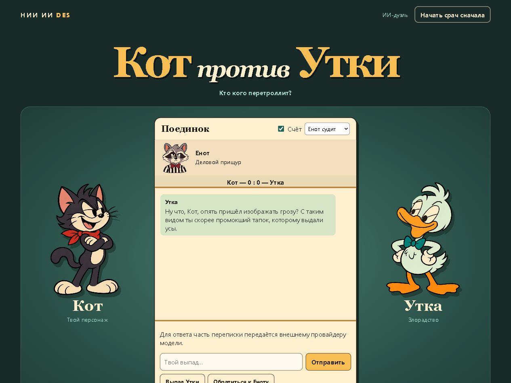

# Кот против Утки

Браузерная словесная дуэль НИИ ИИ DES. Утка отвечает на выпады Кота, меняет мимику и припоминает старые подколы.

[Играть на Котификации](https://duck.котификация.рф/)



## Кто судит

- **Утка считает.** Утка сама решает, кому досталось очко. Её можно поймать на мухлеже. Заставить признать его сложнее.
- **Енот судит.** Если начинает Кот, Енот ждёт ответ Утки. Если начинает Утка, Енот выносит вердикт сразу после ответа Кота. Енот оценивает пару отдельным вызовом модели и может присудить очко любой стороне или оставить счёт прежним.
- Кнопка **«Обратиться к Еноту»** позволяет подколоть судью вне раунда. У арбитров отдельные табло. Кнопка **«Начать срач сначала»** начинает новую дуэль.

## Локальный запуск

Нужен Node.js с `node:sqlite`. Проект проверялся на Node.js 22.23.4 и 24, внешних пакетов нет.

1. Скопируй `.env.example` в `.env`. Заполни `CAT_DUCK_API_KEY` и при необходимости укажи доступные модели в `CAT_DUCK_MODEL` и `CAT_DUCK_RACCOON_MODEL`. По умолчанию оба персонажа используют GPT‑6 Luna с разными промптами. Поддерживается OpenAI-совместимый Chat Completions с JSON mode.
2. Запусти `npm start` и открой [локальную игру](http://127.0.0.1:4173/).
3. Открой эфир на 15 минут с машины, где запущена игра:

   ```sh
   curl -fsS -H 'Content-Type: application/json' -d '{"minutes":15}' http://127.0.0.1:4173/internal/air
   ```

GET на том же адресе показывает статус, POST с `{"minutes":0}` закрывает эфир. Без ключа или при закрытом эфире страница остаётся доступной, а новые запросы к модели блокируются. Лимиты настраиваются через переменные из `.env.example`.

## Данные и публикация игры

История хранится в браузере. Для ответа часть переписки передаётся провайдеру модели. Сервер хранит состояние эфира, счётчики и записи раундов Енота в SQLite, по умолчанию в `.duck-state/`. Для размещения за обратным прокси указывай постоянный `DUCK_STATE_DIR` вне каталога релиза. Держи `/internal/air` доступным только по loopback и настраивай прокси так, чтобы он перезаписывал заголовки адреса клиента.

Проверки запускаются командой `npm test`. Лицензия — [MIT](LICENSE).
